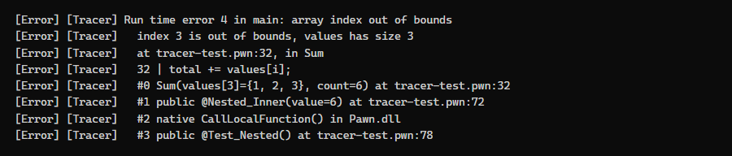
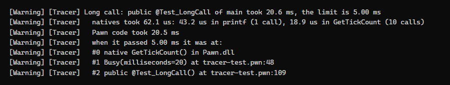
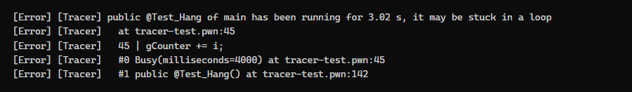
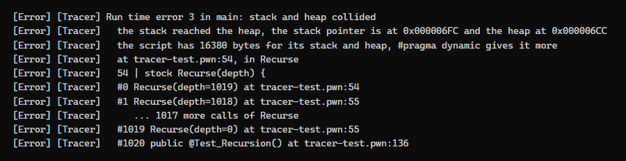
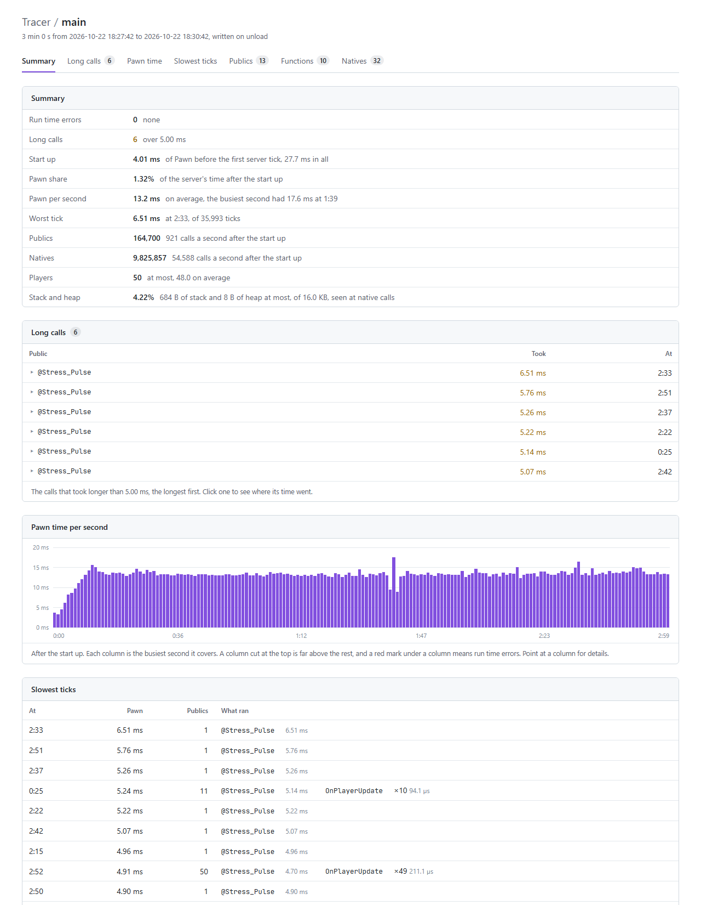

# Tracer

An open.mp component that tells where a Pawn script fails and where its time goes. It reports run time errors with the line, its source and a backtrace with the arguments of every call, calls that take too long or never return, and crashes of the server. It profiles the scripts on demand and writes the results to an HTML report. Every setting lives in `config.json`, and a change to it applies while the server runs.

Tracer does what crashdetect does without an interpreter of its own, so scripts keep running in the interpreter of the server or in PawnJIT.



## What it reports

- **Run time errors** with the file and line, the text of the line, what went wrong, such as the index and the array it went past, and the backtrace with the name and value of every argument. Errors inside `CallLocalFunction` show the call that started them, and the scripts get them in `OnRuntimeError`.
- **Repeated errors** are printed in full once, then summed up in one line every `error_repeat` seconds while they go on.
- **Long calls**, the top level calls that take longer than `long_call_time`, with the time of their natives and of their Pawn code, the slowest native call and where the call was when it passed the limit.
- **Stuck calls**, the calls still running after `hang_time`, found by a watchdog thread while the server is stuck in them.
- **Crashes**, with the native that ran and the line that called it, the Pawn and native backtraces, the registers and the modules of the server.
- **Profiling**, when `profile` is on: Pawn time per second, the slowest ticks, and every public, native and function with its calls, own time, worst call and how its calls spread over time ranges.
- **Tracing** of publics, natives and functions as they are called, filtered with a regular expression.

A long call, with where its time went:



A call stuck in a loop, reported by the watchdog while it runs:



A recursion that ran out of stack, with its repeated calls folded into one line:



The report written while profiling:

<picture>
  <source media="(prefers-color-scheme: dark)" srcset="docs/report-dark.png">
  
</picture>

## Installation

1. Download the latest release from [Releases](https://github.com/imshooter/Tracer/releases).
2. Place `Tracer.dll` in the `components` folder of the server.
3. Place `tracer.inc` in the include folder of the compiler, for scripts that use its natives or `OnRuntimeError`.
4. Remove crashdetect from `pawn.legacy_plugins`. Both report the same errors, and crashdetect runs every script in its own interpreter, which leaves PawnJIT idle.

Compile scripts with `-d3`, or at least `-d2`, so the reports have files, lines, functions and arguments. A script without debug information is reported with code addresses.

Tested with open.mp 1.6.7 on Windows. Only a Windows build is available for now.

## Configuration

Every setting is optional. These are the defaults:

```json
"tracer": {
    "enable": true,
    "scripts": [],
    "errors": true,
    "error_repeat": 10,
    "source": true,
    "long_call_time": 5000,
    "hang_time": 3000,
    "crash": true,
    "trace": "",
    "trace_filter": "",
    "log": "",
    "profile": false,
    "profile_natives": true,
    "profile_callers": true,
    "profile_functions": false,
    "output": "tracer"
}
```

| Key | Description |
| --- | --- |
| `enable` | Turns the component on. |
| `scripts` | Scripts to watch, named as in `pawn.main_scripts` and `pawn.side_scripts`. A side script also matches by its file name. An empty list watches every script. |
| `errors` | Reports run time errors. |
| `error_repeat` | Seconds during which a repeated error is counted instead of printed again. `0` prints every one. |
| `source` | Prints the text of the line an error or a stuck call is at, read from the source files. |
| `long_call_time` | Microseconds a top level call may take before it is reported. `0` turns the check off. |
| `hang_time` | Milliseconds a call may run before the watchdog reports it as stuck. `0` turns the watchdog off. |
| `crash` | Reports crashes of the server. |
| `trace` | What to print as it is called: `p` for publics, `n` for natives and `f` for functions, in any mix. |
| `trace_filter` | A regular expression a traced call must match to be printed. |
| `log` | A file that gets the reports too, with the date of each line. |
| `profile` | Times publics and natives and keeps the statistics of the report. |
| `profile_natives` | Times every native call while profiling. |
| `profile_callers` | Records which publics call each native while profiling. |
| `profile_functions` | Times every function of scripts compiled with `-d2` or `-d3` while profiling. |
| `output` | Folder of the reports, relative to the server. |

### Changes while the server runs

Tracer reads `config.json` again within a second of a change and prints what changed:

```
[Tracer] config.json changed: long_call_time 5000 to 2000, profile false to true
```

A file that is not valid JSON at that moment, as while an editor saves it, leaves the settings as they were. `tracer reload` reads the file at once.

## Console

| Command | Action |
| --- | --- |
| `tracer` | Prints the settings and how many errors and long calls were seen. |
| `tracer report` | Writes a report. |
| `tracer reset` | Clears the statistics, the errors and the long calls. |
| `tracer reload` | Reads `config.json` again. |
| `tracer errors` | Lists every place an error happened, with its count. |

Commands are read from the server console, from RCON and from `SendRconCommand`. A report is also written when the server exits or the main script unloads while profiling. Reports go to `tracer/<script>-<date>.html`, and `tracer/latest.html` is always the newest one.

## Scripts

`tracer.inc` declares the natives and the callback of crashdetect with the same names, so a script written for crashdetect works unchanged:

```pawn
native PrintBacktrace();
native PrintNativeBacktrace();
native GetBacktrace(string[], size = sizeof (string));
native GetNativeBacktrace(string[], size = sizeof (string));
forward OnRuntimeError(code, &bool:suppress);
```

The long call stocks of `crashdetect.inc`, such as `SetCrashDetectLongCallTime` and `RestartCrashDetectLongCall`, are there too, on top of these natives:

```pawn
native Tracer_SetLongCallTime(microseconds);
native Tracer_GetLongCallTime();
native Tracer_GetDefaultLongCallTime();
native Tracer_ResetLongCallTime();
native Tracer_EnableLongCall();
native Tracer_DisableLongCall();
native bool:Tracer_IsLongCallEnabled();
native Tracer_RestartLongCall();
```

## How it finds an error

The interpreter of open.mp stops a call on an error without telling where it was. Tracer keeps the last statement a script reached, from its debug hook, and the last native it called. For an index out of bounds the interpreter does give the instruction, and Tracer reads the index again from the variable it came from. A division by zero is found by the division in the statement, or in the code a call returned to.

When the stack and the heap collide, the interpreter keeps the stack pointer where the script ran out of stack, so every later call of the script fails too. Tracer puts the stack and the heap back as they were when the call started, as the interpreter does after any other error.

Under PawnJIT the generated code skips that debug hook, so it costs nothing there, and a PawnJIT build that provides the `IPawnJITDiagnostics` extension of [`src/pawnjit.hpp`](src/pawnjit.hpp) gives the exact instruction and the registers of every error. The watchdog uses it too, to find the instruction a stuck call runs.

## Overhead

Tracer times the natives of each top level call, to tell where a long call spent its time, and keeps the call stack the backtraces come from. Measured with [`tests/call-cost.pwn`](tests/call-cost.pwn) under PawnJIT:

| | Native call | `CallLocalFunction` |
| --- | --- | --- |
| Without Tracer | 14 ns | 1.69 µs |
| Tracer | 43 ns | 1.77 µs |
| Tracer, `long_call_time` at `0` | 27 ns | 1.80 µs |
| Tracer, `profile` on | 77 ns | 1.84 µs |

On a large gamemode with 60 bots, the whole server used 5.8% of one core with crashdetect and a `-d3` build, and 4.7% with Tracer and PawnJIT on the same build. A `-d0` build used between 4.5% and 5.4% with and without Tracer, a difference within the noise of the runs. Profiling a `-d3` build took it to 5.0%.

## Stress example

[`examples/stress-example.pwn`](examples/stress-example.pwn) keeps 50 bots busy for three minutes. They walk around, look up the zone they stand in, pick up coins, chat and use a command, and every bot is saved to a file every ten seconds. The report above is its report.

1. Compile it with `-d3`.
2. In `config.json`, set `max_players` and `max_bots` to 50 or more, `pawn.main_scripts` to `["stress-example"]` and `tracer.profile` to `true`.
3. Start the server. It shuts down after three minutes and the report is in `tracer/`.

The bots need the NPC component of open.mp.

## Tests

- [`tests/tracer-test.pwn`](tests/tracer-test.pwn) makes every report in one run: an error inside `CallLocalFunction`, one suppressed by `OnRuntimeError`, the backtrace natives, a long call, an error repeated twenty times, a recursion that runs out of stack and a call stuck for four seconds. Run it with `error_repeat` set to `1`.
- [`tests/report-test.pwn`](tests/report-test.pwn) gives every part of the report something to show in four seconds.
- [`tests/call-cost.pwn`](tests/call-cost.pwn) measures the time of a native call and of `CallLocalFunction`, to compare a server with and without Tracer.

## Building

Windows with Visual Studio 2022 or its Build Tools, and CMake 3.19 or later. CMake fetches the open.mp SDK and the Pawn headers.

```
cmake -S . -B build -A Win32
cmake --build build --config Release
```

The component is written to `build/Release/Tracer.dll`. The server is 32 bit, so the component must be too.

## Thanks to

- [@Zeex](https://github.com/Zeex) for crashdetect, whose reports, natives and callback Tracer follows, for subhook, kept in `deps/subhook` under its own license, and for the original profiler plugin.
- [@Y-Less](https://github.com/Y-Less) for the later versions of crashdetect.
- [@ziggi](https://github.com/ziggi) for [samp-plugin-profiler](https://github.com/ziggi/samp-plugin-profiler).
- [@1therealcloud](https://github.com/1therealcloud) for [PawnJIT](https://github.com/1therealcloud/PawnJIT).
- [@openmultiplayer](https://github.com/openmultiplayer) for the [SDK](https://github.com/openmultiplayer/open.mp-sdk) and the [Pawn compiler](https://github.com/openmultiplayer/compiler).

## License

Released under the [MIT License](LICENSE).
